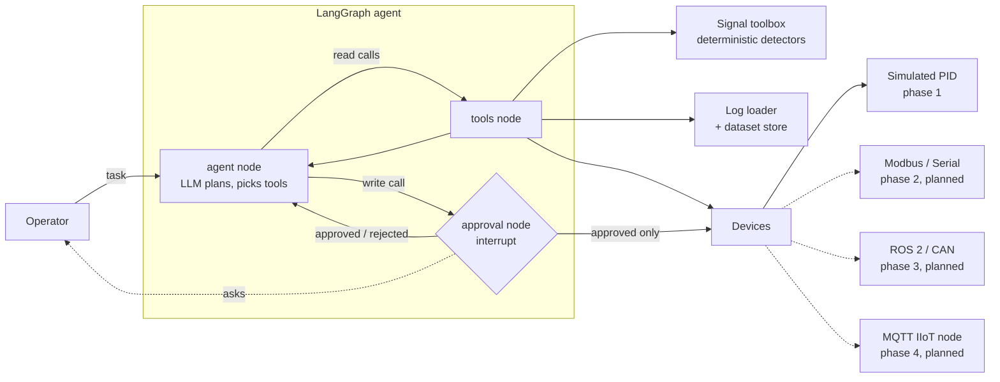

# Embedded/Industrial Diagnostics Agent

An AI agent that connects to embedded and industrial systems, reads signals, detects
anomalies, diagnoses the likely cause and suggests a fix. It only writes to a device
after a human approves the change.

The core idea: **the math is deterministic, the LLM only plans and explains.**
Detectors are plain Python (numpy/scipy) and give the same answer every time. The
LLM decides which tool to call next and writes the report, citing the evidence the
detectors returned.

> Status: **Phase 1 of 4 complete.** Everything below marked "planned" does not exist yet.
> See [Status](#status).

## Phase 1 demo: PID oscillation diagnosis and retune

A simulated PID loop (first-order plant with 0.4 s dead time) is tuned far too
aggressively. The agent captures a step test, finds a sustained oscillation, proposes
new gains, waits for approval, applies them, captures again and compares.


| Metric | Before | After |
|---|---|---|
| Kp / Ki / Kd | 4 / 1.5 / 0 | 1.82 / 0.523 / 0.456 |
| Overshoot [%] | 103.3 | 0.7 |
| Settling time 2% [s] | not settled | 4.30 |
| Rise time 10-90% [s] | 0.20 | 1.27 |
| Sustained oscillation | yes | no |
| Detected anomalies | 2 | 0 |

Produced by `diagagent demo --backend offline --approve yes`. Gains come from
Tyreus-Luyben rules using the measured oscillation period (Pu = 1.58 s) and the
current Kp as a conservative estimate of the ultimate gain.

Example evidence the agent cites:

```
error(setpoint-pv) [1.38s to 27.50s]: decay_ratio = 1.002 (threshold 0.5)
error(setpoint-pv) [1.38s to 27.50s]: period = 1.58s
pv [1.00s to 30.00s]: overshoot_pct = 103.3% (threshold 10%)
```

## Architecture



Safety of writes is enforced in three places:

1. The graph routes any write tool call to the approval node, which pauses with
   LangGraph `interrupt()` until a human answers.
2. The write tool function itself raises `ApprovalRequired` if called directly.
3. The device refuses any `WriteRequest` that is not marked approved, and checks
   parameter names and safe ranges. Every attempt goes to an audit log.

### Short glossary (for the AI parts)

- **Tool**: a Python function with a typed signature and docstring. The LLM sees the
  schema and asks for it to be run; the graph runs it and returns the result.
- **LangGraph**: a library for building agents as a state machine (graph of nodes).
  State (here, the message history) flows between nodes.
- **interrupt / checkpointer**: `interrupt()` pauses a graph run; the checkpointer saves
  its state so it can resume later with the human's answer.
- **Offline planner**: a fixed rule script that stands in for the LLM so the full graph
  runs in CI without a GPU. It is not an LLM and its report is a template.

## Repository layout

```
src/diagagent/
  signals/   detectors.py (oscillation, step response, saturation, dropouts,
             noise, drift, spikes), control.py (loop analysis, hypotheses, retune)
  io/        log_loader.py (CSV/TSV/Parquet/JSON to a standard frame, dataset store)
  sim/       pid_sim.py (FOPDT plant, PID with filter and anti-windup, fault injection)
  devices/   base.py (WriteRequest, audit log), sim_device.py
  agent/     tools.py, graph.py (LangGraph + approval gate), llm.py, runner.py
  cli.py, report.py
tests/       34 pytest tests, no LLM needed
data/        sample_oscillating_loop.csv
```

## Quick start

```bash
python3 -m venv .venv && source .venv/bin/activate
pip install -e ".[dev,ollama]"
pytest

# No LLM needed: deterministic detectors on a log file
diagagent analyze data/sample_oscillating_loop.csv --u-min 0 --u-max 5

# Full agent loop with the offline planner (CI-friendly)
diagagent demo --backend offline --approve ask

# Full agent loop with a local LLM via Ollama
ollama pull qwen2.5:7b
diagagent demo --backend ollama --approve ask

# Optional API backend
pip install -e ".[anthropic]" && export ANTHROPIC_API_KEY=...
diagagent demo --backend anthropic
```

`--approve ask` prompts you in the terminal before any write. `yes` / `no` are for
scripted runs. Results go to `results/` (table, plot, audit log).

## Status

| Phase | Item | State |
|---|---|---|
| 1 | Signal toolbox (7 deterministic detectors) | done, tested |
| 1 | Log loader + dataset store | done, tested |
| 1 | Simulated PID device with fault injection | done, tested |
| 1 | LangGraph agent with approval gate and audit log | done, tested with offline planner |
| 1 | PID oscillation demo, before/after table and plot | done (offline planner) |
| 1 | Run demo with a local Ollama model | done: qwen2.5:7b on RTX 4070 Laptop (8 GB) completes diagnose, approve, retune, verify; same numbers as offline planner |
| 1 | Demo GIF | planned |
| 2 | MCP servers, Modbus RTU/TCP and Serial tools | planned |
| 2 | Real hardware control demo (Arduino/ESP32 PID) | planned |
| 2 | Modbus/OpenPLC alarm diagnosis with a register map | planned |
| 3 | ROS 2 bag tools (IMU drift, dropouts, safety stops), CAN tools | planned |
| 3 | RAG knowledge base over datasheets and manuals | planned |
| 3 | Fault-injection benchmark | planned |
| 4 | MQTT link to the IIoT monitoring node | planned |

## Lessons from the first live LLM run

The first run with `qwen2.5:7b` on Ollama (RTX 4070 Laptop, 8 GB) planned a sensible
tool sequence but chose its own test conditions: a step test at setpoint 100 on a
plant that can reach at most 10, plus actuator limits it made up. The detectors
correctly reported 99.3 % actuator saturation, and the model then called that
"instability". No write was proposed, so nothing reached the device.

Fix: physical limits moved from the prompt into the tools. `get_device_info`
reports the allowed setpoint range and actuator limits, the device refuses step
tests it cannot reach, and `analyze_control_loop` always uses the device's own
limits for captured data. The system prompt now gives a fixed workflow and only
allows "oscillating" when the detector says so. `tests/test_guardrails.py`
replays the bad tool calls and checks the agent gets an error and recovers.

## Known limitations (Phase 1)

- The plant is a simulated first-order-plus-dead-time model, not hardware.
- The retune rule assumes the oscillation is caused by excessive gain. In the demo
  the controller output also touches its lower limit during each cycle; the
  saturation detector reports 12 % time at limit, under its 20 % threshold.
- The step-response detector uses raw samples, so heavy sensor noise inflates the
  overshoot value.

## License

MIT
