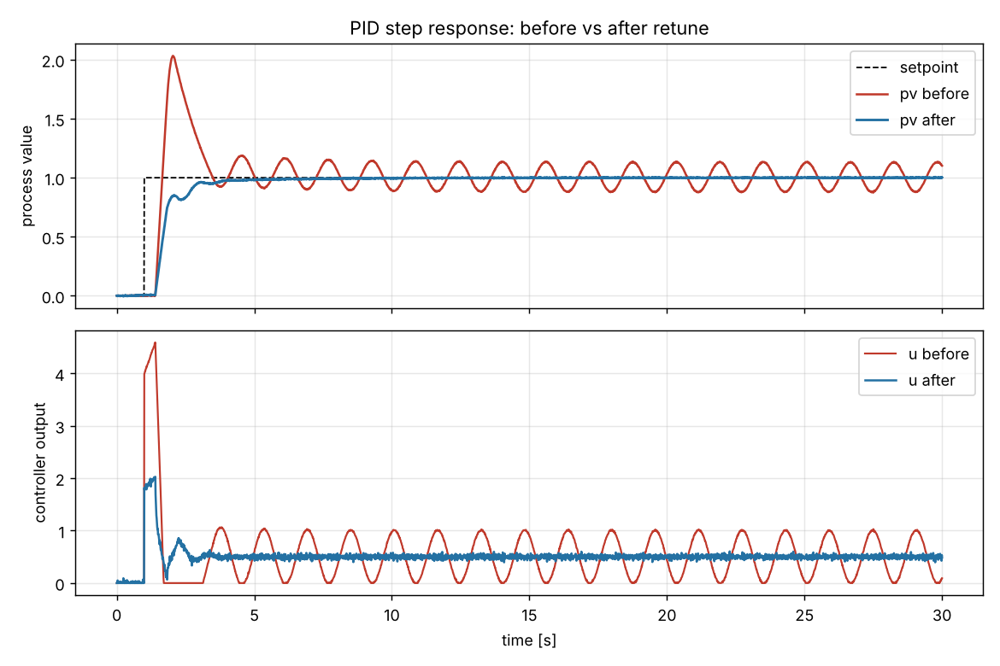
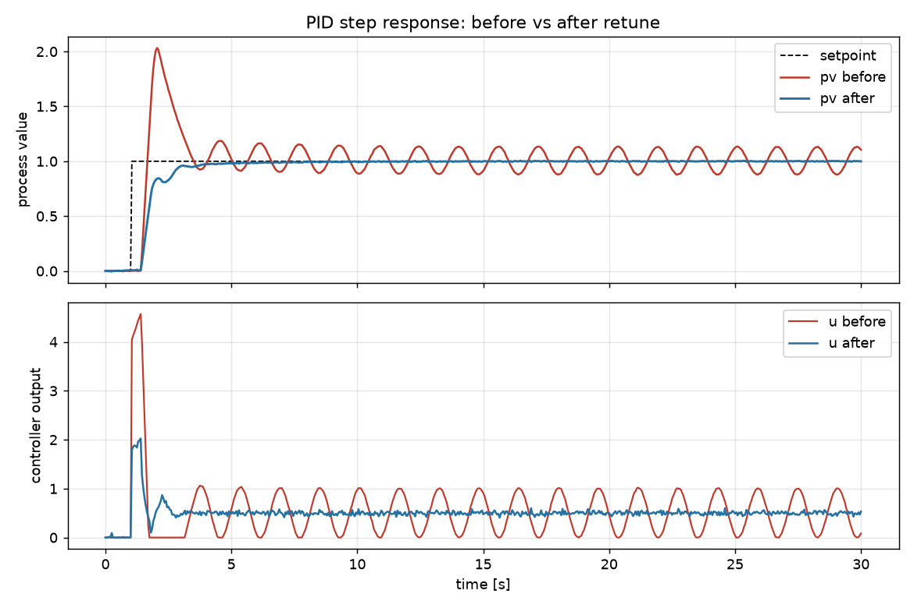
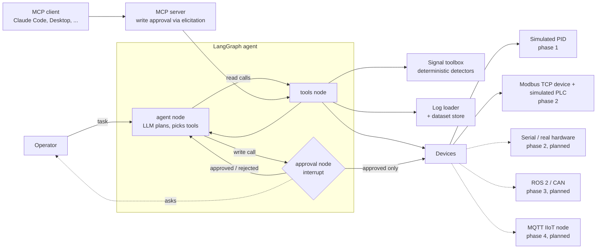

# Embedded/Industrial Diagnostics Agent

[](https://github.com/ihtishamarif/industrial-diagnostics-agent/actions/workflows/ci.yml)

An AI agent that connects to embedded and industrial systems, reads signals, detects
anomalies, diagnoses the likely cause and suggests a fix. It only writes to a device
after a human approves the change.

The core idea: **the math is deterministic, the LLM only plans and explains.**
Detectors are plain Python (numpy/scipy) and give the same answer every time. The
LLM decides which tool to call next and writes the report, citing the evidence the
detectors returned.


> Status: **Phase 1 of 4 complete; Phase 2 is partly done** (MCP server, Modbus TCP and a
> serial device with Arduino firmware are built and tested against simulators; the firmware
> has not been run on the real board yet). Everything marked "planned"
> does not exist yet.
> See [Status](#status).

## Phase 1 demo: PID oscillation diagnosis and retune

A simulated PID loop (first-order plant with 0.4 s dead time) is tuned far too
aggressively. The agent captures a step test, finds a sustained oscillation, proposes
new gains, waits for approval, applies them, captures again and compares.



| Metric | Before | After |
|---|---|---|
| Kp / Ki / Kd | 4 / 1.5 / 0 | 1.82 / 0.523 / 0.456 |
| Overshoot [%] | 103.3 | 0.7 |
| Settling time 2% [s] | not settled | 4.30 |
| Rise time 10-90% [s] | 0.20 | 1.27 |
| Sustained oscillation | yes | no |
| Detected anomalies | 2 | 0 |

Produced by `diagagent demo --backend offline --approve yes`. Gains come from
Tyreus-Luyben rules using the measured oscillation period (Pu = 1.58 s) and the
current Kp as a conservative estimate of the ultimate gain.

Example evidence the agent cites:

```
error(setpoint-pv) [1.38s to 27.50s]: decay_ratio = 1.002 (threshold 0.5)
error(setpoint-pv) [1.38s to 27.50s]: period = 1.58s
pv [1.00s to 30.00s]: overshoot_pct = 103.3% (threshold 10%)
```

## Phase 2: MCP server and Modbus TCP

Same agent, same tools, two new ways in and out.

### The device is now a PLC reached over Modbus TCP

`diagagent demo --device modbus` starts a simulated PLC (a `pymodbus` server running the
same PID plant) and talks to it with real Modbus TCP traffic. The agent code did not
change: `ModbusPIDDevice` implements the same `Device` interface as the simulator.
`diagagent-plc` runs the PLC on its own (default port 5020) so any Modbus client can
connect to it.



| Metric | Before | After |
|---|---|---|
| Kp / Ki / Kd | 4 / 1.5 / 0 | 1.82 / 0.516 / 0.462 |
| Overshoot [%] | 103.3 | 0.5 |
| Settling time 2% [s] | not settled | 4.30 |
| Rise time 10-90% [s] | 0.20 | 1.25 |
| Sustained oscillation | yes | no |
| Detected anomalies | 2 | 0 |

Measured over Modbus TCP with `qwen2.5:7b` via Ollama, and reproduced with the offline
planner. The gains differ slightly from the Phase 1 table because the PLC is sampled every
0.05 s instead of 0.01 s.

Register map (holding registers, real values stored as integers scaled by 1000):

| Address | Meaning | Access |
|---|---|---|
| 0 / 1 / 2 | process value / setpoint / controller output (signed) | read / read-write / read |
| 3 | simulated time since run start (units of 10 ms) | read |
| 10 / 11 / 12 | Kp / Ki / Kd | read-write |
| 20 | run flag (writing 1 resets the loop and starts it) | read-write |
| 30 | status (1 = a gain write was rejected) | read |
| 40 / 41 / 42 | actuator u_min / u_max / highest safe step setpoint | read |

Write safety adds two layers on this path: the client reads every write back and fails
if the device holds a different value, and the PLC checks gain limits itself and reverts
anything out of range, so the safety does not rely on the client alone.

### A serial device (Arduino Uno)

`SerialPIDDevice` talks to a microcontroller over a serial port with a small ASCII line
protocol (`GET`, `SET kp 1.8`, `SP 0.6`, `HOME`, `RUN`; the device streams `D,ms,sp,pv,u`
lines while running). The protocol is documented in `devices/serial_protocol.py`. The
firmware validates gain limits itself, the host reads every write back, and a capture is
refused if the data is stale, has gaps or arrives damaged. Opening the port resets an
Uno, so connecting waits about 2 s.

`firmware/uno_pid/uno_pid.ino` is the Uno side: a 50 Hz PID loop with a `PLANT` switch.

| `PLANT` | Actuator | Sensor | Status |
|---|---|---|---|
| 2 (default) | LED on D9 (12-bit PWM; D3 with 8-bit PWM is an option) | LDR divider on A0 | real loop, no mechanics, auto-calibrates at every reset |
| 1 | servo on D9 (moves for show) | modelled in firmware | emulated plant |
| 0 | servo on D9 | pot on the servo horn, A0 | real loop, needs a coupling and a hand calibration |

With the LED + LDR plant the Uno drives the LED and reads how bright it is, so the loop is
closed through hardware. `u` is the LED duty in [0, 1] and the plant is a lag with a static
gain; with the servo plants `u` is a velocity command in [-1, 1]. The firmware reports its
own limits in `GET`, and the host and the agent use those. Wiring and calibration notes are
in the sketch header. Without hardware, `diagagent-fw` or `diagagent demo --device serial`
run a simulated firmware on a pseudo-terminal (`--fw-plant servo|led`), so the host code is
tested over a real serial device file. The simulated plants (servo lag and speed limit, LED
and LDR lag, LDR exponent, noise, 10-bit ADC) are assumptions, not measurements of the real
parts.

```bash
pip install -e ".[serial]"
diagagent demo --device serial --backend offline --approve yes                  # simulated firmware
diagagent demo --device serial --fw-plant led --backend offline --approve yes   # simulated LED + LDR
diagagent demo --device serial --serial-port /dev/ttyACM0 --backend ollama      # the real board
claude mcp add diagagent -- "$(pwd)/.venv/bin/diagagent-mcp" --serial /dev/ttyACM0
```

### The toolbox as an MCP server

MCP (Model Context Protocol) is an open standard that lets an AI client discover and call
tools served by another process. `diagagent-mcp` exposes the same tools the LangGraph
agent uses (`list_devices`, `get_device_info`, `capture_step_test`, `load_log_file`,
`list_datasets`, `analyze_control_loop`, `suggest_pid_retune`, `compare_datasets`,
`set_pid_gains`) over stdio, so one implementation serves both.

```bash
pip install -e ".[mcp]"
# Claude Code
claude mcp add diagagent -- "$(pwd)/.venv/bin/diagagent-mcp" --audit-out audit.json
# point it at a Modbus device instead of the built-in simulator
claude mcp add diagagent -- "$(pwd)/.venv/bin/diagagent-mcp" --modbus 127.0.0.1:5020
```

For other clients, register the same command in their MCP server settings, for example:

```json
{ "mcpServers": { "diagagent": {
    "command": "/path/to/.venv/bin/diagagent-mcp",
    "args": ["--audit-out", "/tmp/audit.json"] } } }
```

`set_pid_gains` is the only write tool, and the model cannot approve its own write. Before
anything reaches the device, the server asks the human operator through the client
(MCP elicitation: current gains, new gains, reason). If the operator declines, or the
client cannot show the prompt, the write is denied and nothing changes. Every decision,
approved or denied, goes to the audit log. This is covered by tests with a scripted
client; see the limitations below for what has not been tried with a real client.

## Architecture



Safety of writes is enforced in four places:

1. The graph routes any write tool call to the approval node, which pauses with
   LangGraph `interrupt()` until a human answers.
2. The write tool function itself raises `ApprovalRequired` if called directly.
3. The device refuses any `WriteRequest` that is not marked approved, and checks
   parameter names and safe ranges. Every attempt goes to an audit log.
4. Over MCP, `set_pid_gains` asks the operator through the client and is denied if
   the client cannot ask. Over Modbus, writes are read back and the PLC enforces its
   own gain limits.

### Short glossary (for the AI parts)

- **Tool**: a Python function with a typed signature and docstring. The LLM sees the
  schema and asks for it to be run; the graph runs it and returns the result.
- **LangGraph**: a library for building agents as a state machine (graph of nodes).
  State (here, the message history) flows between nodes.
- **interrupt / checkpointer**: `interrupt()` pauses a graph run; the checkpointer saves
  its state so it can resume later with the human's answer.
- **Offline planner**: a fixed rule script that stands in for the LLM so the full graph
  runs in CI without a GPU. It is not an LLM and its report is a template.
- **MCP (Model Context Protocol)**: an open standard for exposing tools to AI clients.
  The client lists the server's tools and calls them; the server does the work.
- **Elicitation**: an MCP feature where the server asks the client's user a question
  mid-call. Here it is how the operator approves a write.
- **Modbus TCP**: an industrial protocol where a client reads and writes numbered
  16-bit registers on a PLC over TCP. Real numbers travel as scaled integers.

## Repository layout

```
src/diagagent/
  signals/   detectors.py (oscillation, step response, saturation, dropouts,
             noise, drift, spikes), control.py (loop analysis, hypotheses, retune)
  io/        log_loader.py (CSV/TSV/Parquet/JSON to a standard frame, dataset store)
  sim/       pid_sim.py (FOPDT plant, PID with filter and anti-windup, fault injection),
             modbus_plc.py (simulated PLC served over Modbus TCP),
             serial_fw.py (simulated Arduino firmware on a pseudo-terminal)
  devices/   base.py (WriteRequest, audit log), sim_device.py,
             modbus_device.py, modbus_regs.py (register map),
             serial_device.py, serial_protocol.py (line protocol)
  agent/     tools.py, graph.py (LangGraph + approval gate), llm.py, runner.py
  mcp_server.py   MCP server (stdio)
  cli.py, report.py
firmware/    uno_pid/uno_pid.ino (Arduino Uno: PID loop, LED + LDR / servo + pot plants)
tests/       79 pytest tests, no LLM needed
data/        sample_oscillating_loop.csv
```

## Quick start

```bash
python3 -m venv .venv && source .venv/bin/activate
pip install -e ".[dev,ollama,mcp,modbus]"
pytest

# No LLM needed: deterministic detectors on a log file
diagagent analyze data/sample_oscillating_loop.csv --u-min 0 --u-max 5

# Full agent loop with the offline planner (CI-friendly)
diagagent demo --backend offline --approve ask

# Same agent, but the device is a simulated PLC reached over Modbus TCP
diagagent demo --backend offline --device modbus --approve ask

# Full agent loop with a local LLM via Ollama
ollama pull qwen2.5:7b
diagagent demo --backend ollama --approve ask

# Optional API backend
pip install -e ".[anthropic]" && export ANTHROPIC_API_KEY=...
diagagent demo --backend anthropic
```

`--approve ask` prompts you in the terminal before any write. `yes` / `no` are for
scripted runs. Results go to `results/` (table, plot, audit log).

## Status

| Phase | Item | State |
|---|---|---|
| 1 | Signal toolbox (7 deterministic detectors) | done, tested |
| 1 | Log loader + dataset store | done, tested |
| 1 | Simulated PID device with fault injection | done, tested |
| 1 | LangGraph agent with approval gate and audit log | done, tested with offline planner |
| 1 | PID oscillation demo, before/after table and plot | done (offline planner) |
| 1 | Run demo with a local Ollama model | done: qwen2.5:7b on RTX 4070 Laptop (8 GB) completes diagnose, approve, retune, verify; same numbers as offline planner |
| 1 | Demo GIF | done |
| 2 | MCP server (read tools, write approval via elicitation) | done, tested with a scripted client |
| 2 | Modbus TCP device + simulated PLC, `--device modbus` | done, tested; live run with qwen2.5:7b |
| 2 | Serial device + Uno firmware, `--device serial` | done, tested over a pseudo-terminal against simulated firmware; sketch compiled and flashed to an Uno (PING, GET, ADC, HOME answer on the board); closed-loop run in emulated-plant mode pending |
| 2 | Real hardware control demo (Uno + LED + LDR) | firmware written and syntax-checked, simulated plant tested; not yet compiled for the AVR or run on the board |
| 2 | Modbus RTU | planned |
| 2 | Modbus/OpenPLC alarm diagnosis with a register map | planned |
| 3 | ROS 2 bag tools (IMU drift, dropouts, safety stops), CAN tools | planned |
| 3 | RAG knowledge base over datasheets and manuals | planned |
| 3 | Fault-injection benchmark | planned |
| 4 | MQTT link to the IIoT monitoring node | planned |

## Lessons from the first live LLM run

The first run with `qwen2.5:7b` on Ollama (RTX 4070 Laptop, 8 GB) planned a sensible
tool sequence but chose its own test conditions: a step test at setpoint 100 on a
plant that can reach at most 10, plus actuator limits it made up. The detectors
correctly reported 99.3 % actuator saturation, and the model then called that
"instability". No write was proposed, so nothing reached the device.

Fix: physical limits moved from the prompt into the tools. `get_device_info`
reports the allowed setpoint range and actuator limits, the device refuses step
tests it cannot reach, and `analyze_control_loop` always uses the device's own
limits for captured data. The system prompt now gives a fixed workflow and only
allows "oscillating" when the detector says so. `tests/test_guardrails.py`
replays the bad tool calls and checks the agent gets an error and recovers.

## Lessons from the Modbus integration

The first Modbus run looked like a success but was not. After the retune, the results
table said "not settled" while the model's summary said the loop was "settling smoothly".
The table was right. The simulated PLC kept the previous run's registers (clock at 30 s,
old process value) after the loop stopped, so the second step test read a stale clock,
decided it was finished after one sample, and returned a flat line.

Fixes: the PLC clears its outputs when the loop stops, the client waits for that before
starting, and the client now refuses data whose first sample is not near t = 0 or that has
a gap longer than 1 s, so stale data raises an error instead of looking like a result. The
new tests compare the Modbus result with the in-process simulator and fail if the bug
is put back.

Takeaways: check the model's prose against the measured numbers (the 7B model also said
Kd was "kept" when it went from 0 to 0.46), and make the data path refuse implausible
data instead of trusting it.

## Lesson from the first run on the real board

The first demo on the Uno failed at its very first serial reads with `SerialException:
device reports readiness to read but returned no data` and `ValueError: could not convert
string to float: ''`, and the same demo failed intermittently in CI against the simulated
firmware (the Modbus demos never did). The wiring was fine: `PING`, `CAL` and `GET` worked
by hand. The cause was in the host: the agent runs the tool calls of one step in parallel
threads, here `get_device_info` and `capture_step_test`, and both read the same serial port.
A serial port is one byte stream, so the threads stole each other's bytes.

Fix: `SerialPIDDevice` holds a lock for the whole of every public call, so a call waits for
the one before it. A new test calls the device from four threads at once; before the fix it
failed 3 times out of 3 with the two errors above, after it it passes. Takeaway: a device
object that wraps one physical link must be safe to call from several threads, because the
agent framework will do that.

## Known limitations (Phase 1 and 2)

- The plants are simulated (first-order-plus-dead-time, and a servo-plus-pot emulation), not hardware measurements.
- The LED + LDR loop ran on the real board and the agent diagnosed and retuned it end to end, but the simulated LED plant is not yet calibrated to the measured one (static curve, Ku about 0.5 to 1, Pu 0.2 s), so simulated and real gains differ by an order of magnitude. The real plant is strongly nonlinear: with the LED close to the LDR the reading saturates at a small duty, and the gain in the demo's operating region is about 3 reading units per unit of duty.
- On the simulated LED plant the retune works for an aggressive-but-settling tune (27 % overshoot to 6.7 %), but not for a high Kp that makes the LED duty bounce between 0 and 1: there the Tyreus-Luyben rule takes the current Kp as the ultimate gain, which overestimates it when saturation is what limits the oscillation, and the retuned loop still rings (about 50 % overshoot in simulation).
- The retune rule assumes the oscillation is caused by excessive gain. In the demo
  the controller output also touches its lower limit during each cycle; the
  saturation detector reports 12 % time at limit, under its 20 % threshold.
- The step-response detector uses raw samples, so heavy sensor noise inflates the
  overshoot value.
- The Modbus device talks to a simulated PLC, not a real one or OpenPLC. Modbus RTU
  is not built yet. The PLC runs 5x faster than real time by default.
- The MCP server is tested with a scripted client. Whether a given real client (for
  example Claude Code or Claude Desktop) shows the approval prompt has not been
  verified; a client without elicitation support simply gets every write denied.
- The LLM's written summary can contain mistakes. The table and the cited tool
  outputs are the source of truth.

## License

MIT
