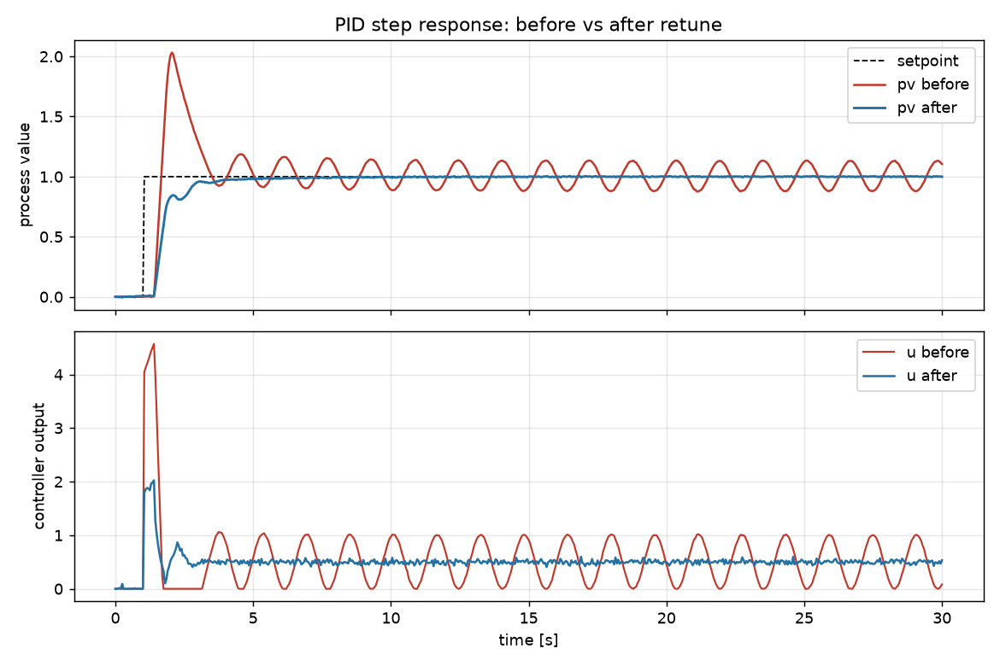

# PID oscillation demo

Backend: `ollama`

| Metric | Before | After |
|---|---|---|
| Kp / Ki / Kd | 4 / 1.5 / 0 | 1.82 / 0.516 / 0.462 |
| Overshoot [%] | 103.3 | 0.5 |
| Settling time 2% [s] | not settled | 4.30 |
| Rise time 10-90% [s] | 0.20 | 1.25 |
| Sustained oscillation | yes | no |
| Detected anomalies | 2 | 0 |

